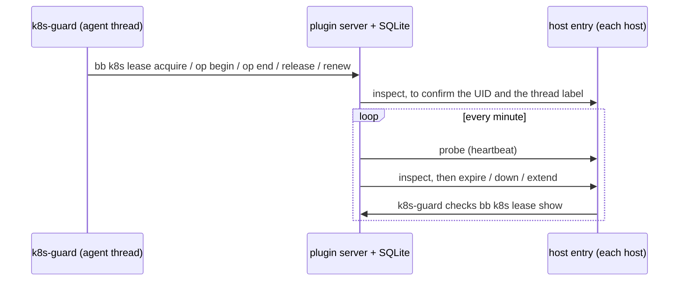

# bb-plugin-k8s-leases

GPU leases for agents on our k8s clusters. A lease holds GPUs of one type, in one namespace on one cluster, for one thread. The plugin keeps the limits per GPU type, fences each write, and tears down every lease that expires, is returned, or loses its thread. `k8s-guard` is the only tool that writes to a cluster. The plugin never runs `kubectl`.

## Install

Only Ryan installs this plugin and changes its settings.

```
bb plugin install git:https://github.com/ryanolson/bb-plugins.git --subdirectory k8s-leases
bb plugin config k8s-leases set hosts '["<machine id>", "<machine id>"]'
bb plugin config k8s-leases set firstRunApprovals '{"<cluster name>":"<record>"}'
bb plugin config k8s-leases set kubeconfig /path/to/the/bot/kubeconfig
```

The clusters come from the cluster profiles on each host: `~/.config/k8s-clusters/profiles.toml`, read with `k8s-check --list` (schema 1). A profile gives the cluster's kube context, `allowed`, `bot_can_write`, `gpu_type` and `gpus_per_node`. A lease stores the cluster's profile name, and every `k8s-guard` call takes `--context <profile context>`.

Install this version before hosts take the k8s-guard that speaks the claim protocol (it calls `bb k8s lease attempt begin` and `lease latest`; an older plugin answers with usage text, and that guard then refuses every leased write). The older guard works with this plugin.

The same order holds for the lease fence: install this plugin first, then let hosts take the guard with `fence probe`. With an older guard the probe cannot run, so every claim refuses `enforcement_unhealthy`. Leases on namespaces the guard creates are not affected.

Cluster names and machine ids are internal. They go only in settings, never in this repository. With no hosts set, `acquire` fails closed.

## Settings

| Setting | Default | Meaning |
|---|---|---|
| `gpuLimits` | `{"gb300":4,"b200":8,"gb200":4,"h100":8}` | Most GPUs of each type at once, over every cluster. |
| `maxLeaseHours` | 4 | The longest lease, and the most time a renewal can leave. |
| `maxRenewals` | 1 | Renewals per lease, by its thread. |
| `graceMinutes` | 60 | Time from revocation to deletion. For an expired lease, it starts at the expiry. |
| `maxExtendHours` | 24 | The most time one Extend from the panel adds. |
| `profilesCommand` | `~/.agents/skills/k8s-clusters/scripts/k8s-check` | Run with `--list` on each host to read the cluster profiles. |
| `clusters` | `{}` | Fallback, used only when no host can read the profiles: cluster names (also used as the kube context), with GPUs per node by type. |
| `firstRunApprovals` | `{}` | Clusters (profile names) whose first run Ryan approved. |
| `multiNodeApprovals` | `[]` | `{cluster, namespace, thread, maxGpus, record}` entries that allow more than one node. |
| `hosts` | `[]` | Machine ids whose host entry runs `k8s-guard`. |
| `guardCommand` | `~/.agents/skills/k8s-clusters/scripts/k8s-guard` | The guard on each host: `~/path`, an absolute path, or a name on PATH. |
| `bbServerUrl` | `http://127.0.0.1:38900` | `BB_SERVER_URL` for the `bb` CLI that the guard runs. Host entries get no `BB_*` variables. |
| `kubeconfig` | empty | `KUBECONFIG` for the guard. Empty means inherit. |

## How it works



- **One process decides.** Every `bb k8s` call runs in the bb server. Each check-and-write is one SQLite transaction with no await inside. So two hosts cannot take the same GPUs, and two writes cannot hold one slot.
- **Acquire** confirms the namespace on a host first: its UID, and its `wcep.agent/thread` label, which must be the calling thread. Then it checks the cluster's profile (not `never`, `bot_can_write`, its GPU type, which must have a limit), the first-run approval, the hours, one node or a multi-node approval, a heartbeat in the last 10 minutes, the limit, and that no other lease holds the namespace.
- **The slot.** `op begin` works only while the lease is active, its one slot is free or past its 2-minute deadline, and no earlier write attempt is unresolved.
- **Claims of a pre-made namespace.** Where the bot cannot create namespaces, ops made one per cluster, named in the profiles as `[bot] premade_namespace`. `acquire --claim` takes it: the owner is the calling thread, a host checks the exact profile name, both opt-in labels and the live UID, and one transaction decides health, exclusivity, the expected predecessor and the budget. The lease's row is the claim, the charge and the completion. The same request id returns its recorded outcome; the same owner adopts its matching active lease; a new claim replaces only the namespace's latest lease, which must have ended, and keeps it as `predecessor`. A claim also needs the lease fence, below.
- **The lease fence.** Ops install two Kyverno policies, each with its own fine-grained webhook entry scoped to the pre-made namespace. `agent-lease-fence` admits Pods there only under the lease its gate ConfigMap names. `agent-lease-fence-canary` always refuses one labelled probe Pod, so a probe can tell which webhook answered. The plugin never reads the gate; the guard writes it.
  - **Enrolled.** A claim refuses `namespace_not_enrolled` unless the namespace carries `dynamo.nvidia.com/agent-lease-fence: "true"`. Ops set that label. The plugin checks it with its own `inspect` on a host, before the probe.
  - **The probe.** Before every fresh claim, one host runs `k8s-guard fence probe`: two server dry-run Pod creates, read only. The canary Pod goes to `agent-lease-fence-canary` and shows which webhook answered. The mode Pod goes to `agent-lease-fence` and shows whether it enforces, and through which entry (`mode_entry`). The guard derives `scope` from both. A fence that is not armed comes with `cause`, the guard's words for why. A replay of a recorded request does not probe; it returns its outcome first.
  - **What a probe proves.** In Audit, the canary proves only its own entry: `agent-lease-fence` denies nothing then, so its entry shows only through the mode Pod. During a Kyverno outage, a refused create proves that one of our two entries is in place, not both. Scaling the Kyverno admission controller to 0 deletes every Kyverno webhook. The probe then reads not armed, the charge stays, and the cause names it.
  - **The gate.** A claim needs mode `enforcing` with scope `finegrained`. Anything else refuses `enforcement_unhealthy`, and the error quotes the probe: the cause, canary, mode, scope and the server texts. The JSON carries `canary`, `mode`, `scope` and `cause`. A probe that cannot run also refuses. The rule is `K8sLeasesOptions.fenceGate`, a code option, never a setting.
  - **The trial.** `--audit-trial` is a claim made while the policy is still in Audit, as each cluster's first run. It needs `--claim`, `--gpus 1`, the first-run approval for the cluster, and mode `audit` with scope `finegrained`. The guard refuses every GPU request and every build under a trial. A trial is one of the claim's terms, so a normal claim never adopts a trial lease.
  - **The sequence.** Each claim gets `seq`, one more than every earlier claim on that kube context and namespace, in any state. It is never reused. An adopted lease keeps its `seq`, and a replay returns its first one. The guard writes `seq` into the gate, and the policy lets it only rise. A claim's reply carries `seq` and `trial`; `lease show` carries `claim_seq` and `trial`.
  - **The live probe.** The enforcer probes each active claimed lease on every fifth tick, about every 5 minutes. A fence that is not armed, or a probe that cannot run, raises one `fence_disarmed` flag with the cause. A trial lease that reads Audit through a fine-grained webhook is as granted, and is not flagged. The probe frees nothing and revokes nothing; it tells a person early, before teardown.
- **Write attempts.** k8s-guard records each write under a lease (`attempt begin`, with the slot's token) before it sends it, and resolves it after (`attempt resolve`). An open attempt blocks the next write and keeps a claimed lease's teardown from completing. Every recorded or resolved attempt moves the lease's attempt epoch.
- **Reconcile.** A schedule runs every minute. It reads the lease table and starts the work, awaiting nothing first: for every live lease a teardown (if not active), an inspection, and a thread check (if active), plus a probe of every host and a read of the profiles. Each call has its own timeout, so no slow host, lookup or call holds up the others.
  - An expired lease moves to `revoking` at once. The thread check asks bb about the lease's thread, with a 20-second limit. When it finishes and bb reports the thread archived, deleted or missing, the lease moves to `revoking`.
  - `inspect` goes to every healthy host at once. The first answer that shows more GPUs than the lease, or GPUs of another or unknown type, revokes the lease.
  - A lease that is not active gets a fresh `k8s-guard expire` on every tick, sent to every healthy host at once, whatever `inspect` says. `expire` only reduces, so one success is enough.
  - `down` runs when the grace deadline passes, or at once for a returned lease, started beside `expire`, not after it. It runs once per lease, on one host at a time, with the hosts whose last call failed tried last. A `down` that works has only started the deletion: the GPUs stay charged until `inspect` reports the namespace gone, and GPU pods still terminating raise one `gpu_pods_left` flag. A namespace still there 15 minutes after its first `down` raises a `teardown_failing` flag.
  - A guard result is either a host fault or a refusal. A host fault (spawn error, timeout, no JSON, kubectl or connection error) moves a call on to the next host. A refusal (`uid_mismatch`, `lease_active`, `lease_ended`, `lease_mismatch`, `lease_not_active`, `not_expired`, `record_conflict`, `lease_record_missing`, `not_found`, `teardown_incomplete`, `object_not_yours`, `fence_mismatch`, `fence_not_retired`) is an answer: it never moves a call on and never cools a host down. `uid_mismatch` on a teardown is flagged as a re-created namespace, and it never frees GPUs on its own. `lease_record_missing` (the namespace has no lease record, because acquire failed after the grant) is flagged once, and tells the user to release the lease.
  - A namespace whose `expires-at` differs from the lease gets `k8s-guard extend`, one at a time per lease. `k8s-guard` decides where a namespace keeps its `expires-at`. The plugin reads it only through `inspect`.
- **Teardown is narrow.** Every write passes the lease's namespace UID, and the guard refuses a write to a namespace with another UID.
- **GPUs free late.** A lease frees its GPUs only when at least one host reports its namespace gone or re-created, and no host that answered still sees it. The report must come from a call that started after the last call that saw the namespace. A host that gives no answer frees nothing.
- **A claimed lease completes once.** Its namespace is never deleted, so its GPUs never free on a namespace read. A `down` on a host closes the gate, resolves its open attempts, deletes its objects, waits out the drain, reads them again, and reports `complete` or `teardown_incomplete` with what it resolved. Completion and the return of the GPUs are one transaction. It needs the exact closing lease, its namespace UID, an attempt epoch unchanged since that `down` was started, and no open attempt. It also needs the guard's fence report to show all three of these:
  - the gate read back as `closing` for this lease and this lease's `seq`;
  - a drain of at least W = 120 s of monotonic time. W is the plugin's own constant (`DRAIN_MS`). The guard's own drain setting never lowers it;
  - `armed: continuous`: the fence was armed before the close, through the drain and after the final read. For a trial lease, `armed: trial` also counts: the canary answered through our entry and the mode read Audit throughout. A lease that is not a trial never completes on `armed: trial`.

  A report that misses any of them frees nothing; the lease keeps a note of why. A stale or replayed result frees nothing. The drain is a wait before a final check, not a timer that frees GPUs: an attempt nobody can resolve still holds the GPUs, and is flagged after 15 minutes.
- **A disarmed fence.** A `teardown_incomplete` that says the fence was not armed raises one `fence_disarmed` flag, and the GPUs stay charged. The flag and the lease's note (`last_error`, in the panel and in `lease show`) carry the guard's cause, or "the fence was not armed (no cause given)". There are two ways out. Ops re-arm the fence (Enforce, the label or the policy), and the next teardown completes. Or ops retire the fence for good: they remove the label and the policy. Then a person on a host (never a thread: `not_from_thread`) records the proof with `bb k8s lease fence-retired <lease_id> --proof <url>`. The lease must be claimed and in teardown. Every later `down` passes `--fence-retired <url>`, and the guard checks that the label is gone and the canary is admitted. Completion then accepts `armed: retired`, but only with the recorded proof and a report that the namespace is no longer enrolled. It raises a `fence_retired_completion` flag. If the guard refuses the proof (`fence_not_retired`: the label is still on, or the canary is still refused), the plugin clears the proof and raises one `fence_retired_refused` flag. The next teardown takes the armed path again, so a re-armed fence still completes.
- **Extend.** The panel lists every lease. Each active lease has an Extend button: +30 min, +1 h, +2 h, or a custom amount. The plugin moves the expiry, records the extension, and runs `k8s-guard extend` at once.

## Known limits

- bb has no setting or RPC that only Ryan can use. Any agent can change these settings or call the `extend` RPC. So every settings change and every extension is raised as a flag for the steward's digest. The runbook tells agents never to do either.
- The `bb` CLI forwards the calling thread from `BB_THREAD_ID` without checking it. A process that sets it can act as another thread.
- The Kubernetes API cannot be fenced by the slot. A write that stalls after its last check can land late. The next tick undoes it.
- If the bb server or the plugin is down, nothing in this plugin runs. The offline timer of `k8s-sweep` scales to 0 at `expires-at` and deletes after the grace period. A claimed namespace keeps no `expires-at`, so nothing acts on it while the plugin is down.
- Claims stay off until ops install both fence policies, enroll the namespace and switch `agent-lease-fence` to Enforce. Before that, only trial claims under Audit pass.
- The live probe runs every 5 minutes, and a teardown probes about every 5 s. A fence emptied and restored between two probes is not seen.
- In Audit the canary proves only its own entry, and an outage proves one of our two entries, not both. Only ops' read of the webhook configuration proves both expressions.
- The live probe's cause goes to the `fence_disarmed` flag only. An active lease's note is cleared by the next good inspect, so the note carries the cause only for a lease in teardown.
- A Pod create admitted while the gate was open, and slower than W to land, is not seen by the final read. Garbage collection may remove it, since its owners are gone (untested); `k8s-sweep` flags it as `gpus_no_lease`.
- `seq` counts per kube context and namespace. Two contexts that reach one cluster count apart, and the guard then refuses the second context's lower `seq` with `fence_mismatch`.
- A namespace that never finishes deleting keeps its GPUs charged. It is flagged after 3 failed ticks.

## Development

```
npm install
npm test               # about 10 s
npx tsc -p .
bb plugin build .
```

The plugin's SQLite schema is version 3, in `lib/store.ts`: version 1 is the first install, version 2 adds claims and write attempts, and version 3 adds the fence's `claim_seq`, `trial` and `fence_retired_proof`. Migrations are append-only: never edit or reorder a shipped statement; add a new one after it.

The contract test runs the plugin against the real `k8s-guard`, through the real host entry, on the guard's own fake `kubectl` and fixtures (`contract/world.py`). It never touches a real cluster. It needs the guard repository checked out at the commit pinned in `contract.test.ts` (`GUARD_COMMIT`). Without `K8S_GUARD_REPO` it is skipped.

```
K8S_GUARD_REPO=/path/to/dynamo-dotfiles npm run test:contract   # about 70 s
```

The tests use a fake `k8s-guard` and a fake bb thread lookup (`test-support.ts`). The host entry tests run a fake `k8s-guard` and a fake `bb` on a PATH that holds nothing else.
