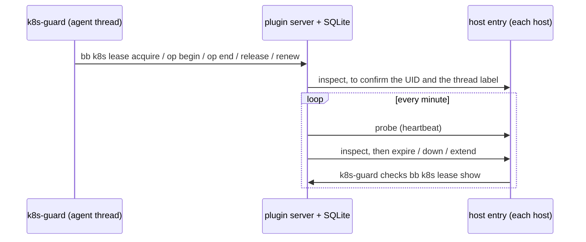

# bb-plugin-k8s-leases

GPU leases for agents on our k8s clusters. A lease holds GPUs of one type, in one namespace on one cluster, for one thread. The plugin keeps the limits per GPU type, fences each write, and tears down every lease that expires, is returned, or loses its thread. `k8s-guard` is the only tool that writes to a cluster. The plugin never runs `kubectl`.

## Install

Only Ryan installs this plugin and changes its settings.

```
bb plugin install git:https://github.com/ryanolson/bb-plugins.git --subdirectory k8s-leases
bb plugin config k8s-leases set hosts '["<machine id>", "<machine id>"]'
bb plugin config k8s-leases set firstRunApprovals '{"<cluster name>":"<record>"}'
bb plugin config k8s-leases set kubeconfig /path/to/the/bot/kubeconfig
```

The clusters come from the cluster profiles on each host: `~/.config/k8s-clusters/profiles.toml`, read with `k8s-check --list` (schema 1). A profile gives the cluster's kube context, `allowed`, `bot_can_write`, `gpu_type` and `gpus_per_node`. A lease stores the cluster's profile name, and every `k8s-guard` call takes `--context <profile context>`.

Cluster names and machine ids are internal. They go only in settings, never in this repository. With no hosts set, `acquire` fails closed.

## Settings

| Setting | Default | Meaning |
|---|---|---|
| `gpuLimits` | `{"gb300":4,"b200":8,"gb200":4,"h100":8}` | Most GPUs of each type at once, over every cluster. |
| `maxLeaseHours` | 4 | The longest lease, and the most time a renewal can leave. |
| `maxRenewals` | 1 | Renewals per lease, by its thread. |
| `graceMinutes` | 60 | Time from revocation to deletion. For an expired lease, it starts at the expiry. |
| `maxExtendHours` | 24 | The most time one Extend from the panel adds. |
| `profilesCommand` | `~/.agents/skills/k8s-clusters/scripts/k8s-check` | Run with `--list` on each host to read the cluster profiles. |
| `clusters` | `{}` | Fallback, used only when no host can read the profiles: cluster names (also used as the kube context), with GPUs per node by type. |
| `firstRunApprovals` | `{}` | Clusters (profile names) whose first run Ryan approved. |
| `multiNodeApprovals` | `[]` | `{cluster, namespace, thread, maxGpus, record}` entries that allow more than one node. |
| `hosts` | `[]` | Machine ids whose host entry runs `k8s-guard`. |
| `guardCommand` | `~/.agents/skills/k8s-clusters/scripts/k8s-guard` | The guard on each host: `~/path`, an absolute path, or a name on PATH. |
| `bbServerUrl` | `http://127.0.0.1:38900` | `BB_SERVER_URL` for the `bb` CLI that the guard runs. Host entries get no `BB_*` variables. |
| `kubeconfig` | empty | `KUBECONFIG` for the guard. Empty means inherit. |

## How it works



- **One process decides.** Every `bb k8s` call runs in the bb server. Each check-and-write is one SQLite transaction with no await inside. So two hosts cannot take the same GPUs, and two writes cannot hold one slot.
- **Acquire** confirms the namespace on a host first: its UID, and its `wcep.agent/thread` label, which must be the calling thread. Then it checks the cluster's profile (not `never`, `bot_can_write`, its GPU type, which must have a limit), the first-run approval, the hours, one node or a multi-node approval, a heartbeat in the last 10 minutes, the limit, and that no other lease holds the namespace.
- **The slot.** `op begin` works only while the lease is active and its one slot is free or past its 2-minute deadline.
- **Reconcile.** A schedule runs every minute. It reads the lease table and starts the work, awaiting nothing first: for every live lease a teardown (if not active), an inspection, and a thread check (if active), plus a probe of every host and a read of the profiles. Each call has its own timeout, so no slow host, lookup or call holds up the others.
  - An expired lease moves to `revoking` at once. The thread check asks bb about the lease's thread, with a 20-second limit. When it finishes and bb reports the thread archived, deleted or missing, the lease moves to `revoking`.
  - `inspect` goes to every healthy host at once. The first answer that shows more GPUs than the lease, or GPUs of another or unknown type, revokes the lease.
  - A lease that is not active gets a fresh `k8s-guard expire` on every tick, sent to every healthy host at once, whatever `inspect` says. `expire` only reduces, so one success is enough.
  - `down` runs when the grace deadline passes, or at once for a returned lease, started beside `expire`, not after it. It runs once per lease, on one host at a time, with the hosts whose last call failed tried last. A namespace still there 5 minutes after its first `down` raises a `teardown_failing` flag.
  - A namespace whose `expires-at` differs from the lease gets `k8s-guard extend`, one at a time per lease. `k8s-guard` decides where a namespace keeps its `expires-at`. The plugin reads it only through `inspect`.
- **Teardown is narrow.** Every write passes the lease's namespace UID, and the guard refuses a write to a namespace with another UID.
- **GPUs free late.** A lease frees its GPUs only when at least one host reports its namespace gone or re-created, and no host that answered still sees it. The report must come from a call that started after the last call that saw the namespace. A host that gives no answer frees nothing.
- **Extend.** The panel lists every lease. Each active lease has an Extend button: +30 min, +1 h, +2 h, or a custom amount. The plugin moves the expiry, records the extension, and runs `k8s-guard extend` at once.

## Known limits

- bb has no setting or RPC that only Ryan can use. Any agent can change these settings or call the `extend` RPC. So every settings change and every extension is raised as a flag for the steward's digest. The runbook tells agents never to do either.
- The `bb` CLI forwards the calling thread from `BB_THREAD_ID` without checking it. A process that sets it can act as another thread.
- The Kubernetes API cannot be fenced by the slot. A write that stalls after its last check can land late. The next tick undoes it.
- If the bb server or the plugin is down, nothing in this plugin runs. The offline timer of `k8s-sweep` scales to 0 at `expires-at` and deletes after the grace period.
- A namespace that never finishes deleting keeps its GPUs charged. It is flagged after 3 failed ticks.

## Development

```
npm install
npm test               # about 7 s
npx tsc -p .
bb plugin build .
```

The tests use a fake `k8s-guard` and a fake bb thread lookup (`test-support.ts`). The host entry tests run a fake `k8s-guard` and a fake `bb` on a PATH that holds nothing else.
